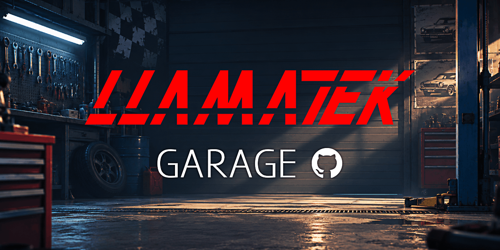
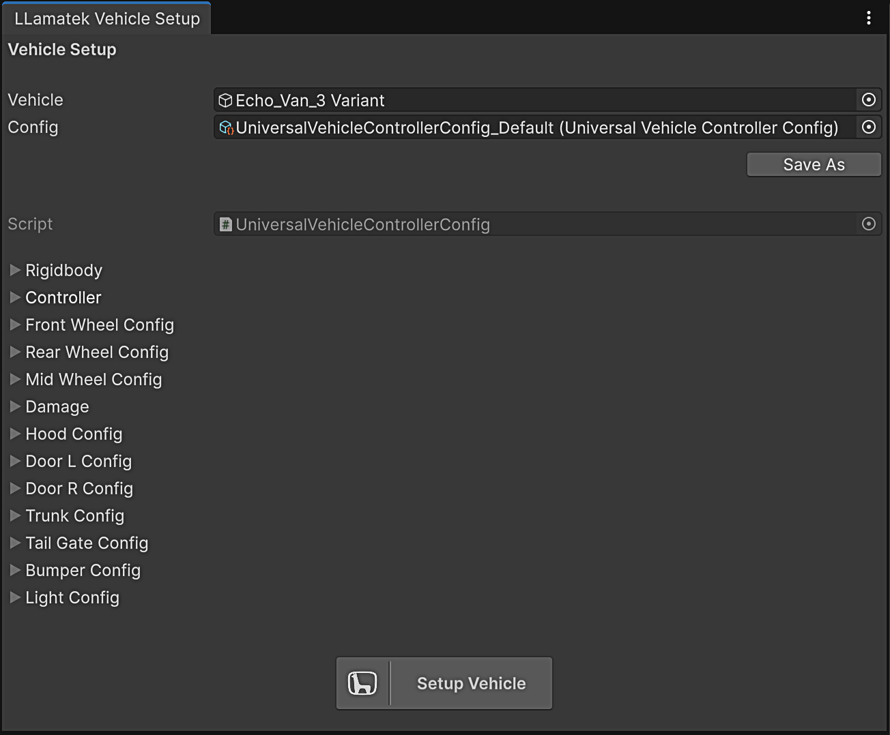
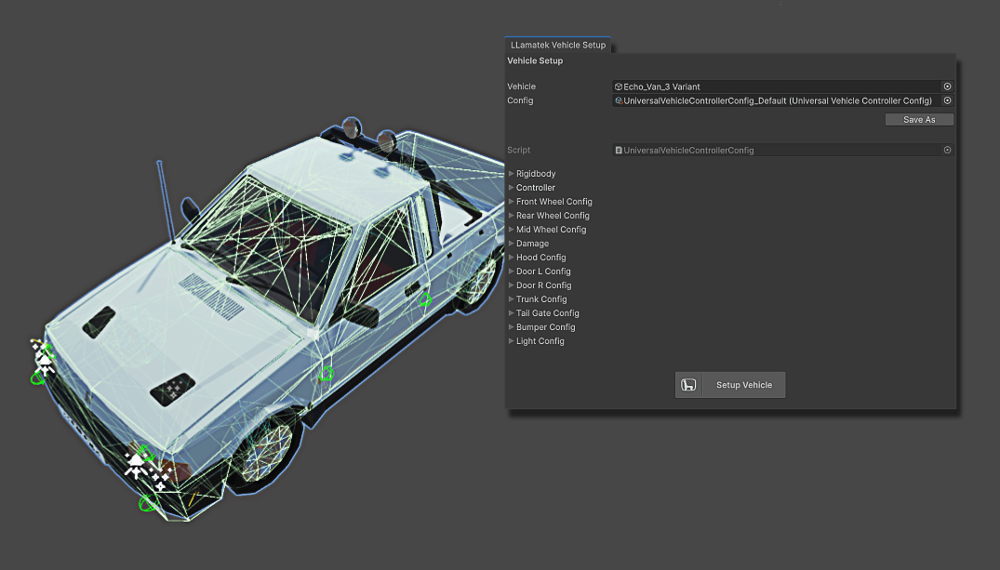

  

# LLamatek Universal Vehicle Controller Integration

Auto-setup integration for LLamatek vehicles with Universal Vehicle Controller.

### What It Does

Automatically assigns the required components and configures your entire LLamatek vehicle to work with Universal Vehicle Controller.

No manual component setup required. Just click **Setup Vehicle** and your vehicle is ready to drive! ❤️

### Requirements

- Unity 2022.3
- [Universal Vehicle Controller Plus](https://assetstore.unity.com/packages/tools/physics/universal-vehicle-controller-plus-176314)
- A compatible LLamatek vehicle

### Installation

1. Import the `.unitypackage` into your Unity project.

### Setup

1. Open **LLamatek → UniversalVehicleController → Setup**.
2. Drag your vehicle's Suspension GameObject into the Vehicle field.
3. Unpack the vehicle prefab if needed.
4. Adjust the configuration settings.
5. Click **Save As** to save your configuration.
6. Click **Setup Vehicle** to configure your vehicle.

  

  

